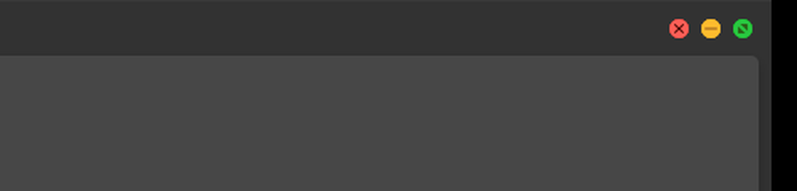

# Mac Traffic Lights

Native-style macOS traffic-light window controls for Zen Browser.

  
  Captured from the running mod (Zen 1.23.2b, Windows, dark theme, 3× upscale for readability — see <a href="docs/capturing-screenshots.md">docs/capturing-screenshots.md</a>).

Close = red, minimize = yellow, zoom/maximize = green, in macOS order, with
the same disc size and spacing. Hovering the group shows the three small
macOS marks. On Windows the buttons keep their real close/minimize/
maximize functions — the mod only restyles Zen's own window controls, it
never replaces them.

Based on [Zen Minimal Exit Menu](https://github.com/dinnoyow/zen-minimal-exit-menu)
by DinnoDEV, whose color mapping (minimize green, maximize yellow) didn't
match the macOS design this mod aims for. This is a full rework targeting
Zen 1.23.x.

## What it changes

- Window buttons reordered to close / minimize / zoom, left to right
- 12px discs, 20px center spacing, macOS fill and rim colors,
  measured on the Catalina→Sequoia design
- Rides Zen's own auto-hidden top toolbar: the group is hidden while
  the toolbar is collapsed, expands with it when you hover near the
  top edge, and hides again with it — no separate hover system
- Group hover reveals all three marks (as native macOS does)
- Subtle darken when pressed; an inactive-window gray state is
  styled but is not yet verified to render (see below)
- Light and dark theme aware; hover states are instant — no CSS
  animations
- Windows and Linux only — on macOS Zen already draws real traffic
  lights, so nothing here overrides them

## Install

**Not yet in the official Zen Mods registry** — install manually from
source for now:

1. Clone or download this repository.
2. Follow [Zen's guide to loading a theme locally](https://docs.zen-browser.app/guides/using-themes)
   — the entry point is `chrome.css`, preferences come from
   `preferences.json`.
3. Restart Zen.

Once the mod is accepted into the official registry, it will install
from `zen://mods` (Settings → Mods) like any other theme. Check the
releases page for status.

## Preferences

| Setting | Default | What it does |
|---|---|---|
| Use Zen's native window controls instead | off | Puts the mod to sleep; you get the stock Windows controls back |
| Hide the hover glyphs | off | Keeps the plain colored discs, no marks on hover |

## Known limitations & untested configurations

Tested: Windows 11, Zen 1.23.2b (Firefox 157), 100% DPI, vertical tabs,
single-toolbar layout, dark theme, auto-hidden toolbar — close/minimize/
maximize/restore clicks, hover reveal/hide, glyph reveal. Full matrix in
[`docs/testing-guide.md`](docs/testing-guide.md). **Not verified** (code
is in place, claims are not):

- Windows Snap Layouts flyout and title-bar dragging (the native
  appearance flag is untouched, but no drag test was run)
- Compact mode, multi-toolbar layouts, sidebar on either side, narrow
  windows (~600px)
- Inactive-window gray state — the rule ships and relies on the same
  selector Zen itself uses, but Gecko would not repaint the unfocused
  window in the harness, so it was never observed
- Light theme (dark theme is the one captured), HiDPI / mixed-DPI
  scaling other than 100%
- Linux entirely — nothing in the CSS targets macOS, but no Linux test
  was run
- Native tooltips ("Close", "Minimize", …) still appear with Firefox's
  built-in delay: suppressing only these buttons' tooltips is not
  possible with CSS — the tooltip is native (not stylable from a
  user sheet per-button), and browser-wide tooltip hiding would also
  kill tab and toolbar hints, so this mod doesn't do it. The buttons'
  accessible names are unaffected either way.

The glyph set is hand-traced from measured macOS screenshots, not
extracted Apple assets — shapes are extremely close but pixel-sampled
against a live macOS screen rather than traced Apple vectors. On Linux,
Zen/Firefox may draw window decorations itself depending on your
desktop environment and CSD settings; results vary.

See [CHANGELOG.md](CHANGELOG.md) for version history.

## Attribution

Original concept and code by DinnoDEV
([zen-minimal-exit-menu](https://github.com/dinnoyow/zen-minimal-exit-menu)),
MIT licensed. The reference measurements used to build the discs and
marks come from the community: [traffic light measurements](https://cephalochromoscope.net/25daf24d-cc23-4f31-994d-7dbc9576ebd4)
and the CC0 SVG set from
[lwouis/macos-traffic-light-buttons-as-SVG](https://github.com/lwouis/macos-traffic-light-buttons-as-SVG).
No Apple assets appear in this repository.

## License

MIT — see [LICENSE](LICENSE).