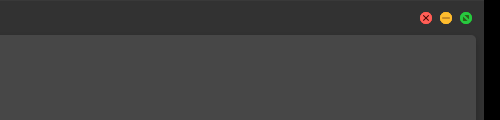

# Mac Traffic Lights

Native-style macOS traffic-light window controls for Zen Browser.

  
  Captured from the running mod (Zen 1.23.2b, Windows, dark theme, 3× upscale for readability — see <a href="docs/capturing-screenshots.md">docs/capturing-screenshots.md</a>).

Close = red, minimize = yellow, zoom/maximize = green, in macOS order, with
the same disc size and spacing. Hovering the group shows the three small
macOS marks, and an inactive window dims to neutral gray. On Windows both
buttons keep their real functions — including Snap Layouts flyouts —
because the mod only restyles Zen's own window controls, it never replaces
them.

Based on [Zen Minimal Exit Menu](https://github.com/dinnoyow/zen-minimal-exit-menu)
by DinnoDEV, whose color mapping (minimize green, maximize yellow) didn't
match the macOS design this mod aims for. This is a full rework targeting
Zen 1.23.x.

## What it changes

- Window buttons reordered to close / minimize / zoom, left to right
- 12px discs, 20px center spacing, macOS fill and rim colors,
  measured on the Catalina→Sequoia design
- Rides Zen's own auto-hidden top toolbar: the group is hidden while
  the toolbar is collapsed, expands with it when you hover near the
  top edge, and hides again with it — no separate hover system
- Group hover reveals all three marks (as native macOS does)
- Subtle darken when pressed, neutral gray discs on inactive windows
- Light and dark theme aware; respects `prefers-reduced-motion`
- Windows and Linux only — on macOS Zen already draws real traffic
  lights, so nothing here overrides them

## Install

Get it the standard way:

1. Open `zen://mods` in Zen Browser (Settings → Mods).
2. Find **Mac Traffic Lights** and click Install.

Or load it manually from source: clone or download this repository,
then follow [Zen's guide to loading a theme locally](https://docs.zen-browser.app/guides/using-themes)
— the entry point is `chrome.css`, preferences come from
`preferences.json`.

## Preferences

| Setting | Default | What it does |
|---|---|---|
| Use Zen's native window controls instead | off | Puts the mod to sleep; you get the stock Windows controls back |
| Hide the hover glyphs | off | Keeps the plain colored discs, no marks on hover |

## Known limitations

- The glyph set is hand-traced from measured macOS screenshots, not
  extracted Apple assets — shapes are extremely close but pixel-sampled
  against a live macOS screen rather than traced Apple vectors.
- On Linux, Zen/Firefox may draw window decorations itself depending
  on your desktop environment and CSD settings; results vary between
  environments.
- Windows is the tested platform. Linux behavior is checked in code
  but not guaranteed to match every window manager.

See [CHANGELOG.md](CHANGELOG.md) for version history.

## Attribution

Original concept and code by DinnoDEV
([zen-minimal-exit-menu](https://github.com/dinnoyow/zen-minimal-exit-menu)),
MIT licensed. The reference measurements used to build the discs and
marks come from the community: [traffic light measurements](https://cephalochromoscope.net/25daf24d-cc23-4f31-994d-7dbc9576ebd4)
and the CC0 SVG set from
[lwouis/macos-traffic-light-buttons-as-SVG](https://github.com/lwouis/macos-traffic-light-buttons-as-SVG).
No Apple assets appear in this repository.

## License

MIT — see [LICENSE](LICENSE).